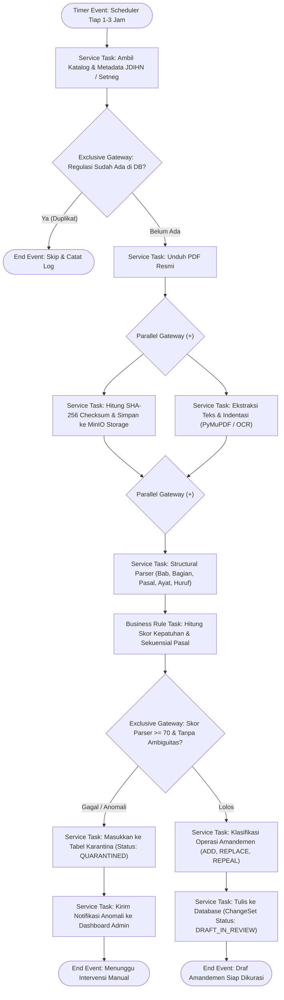
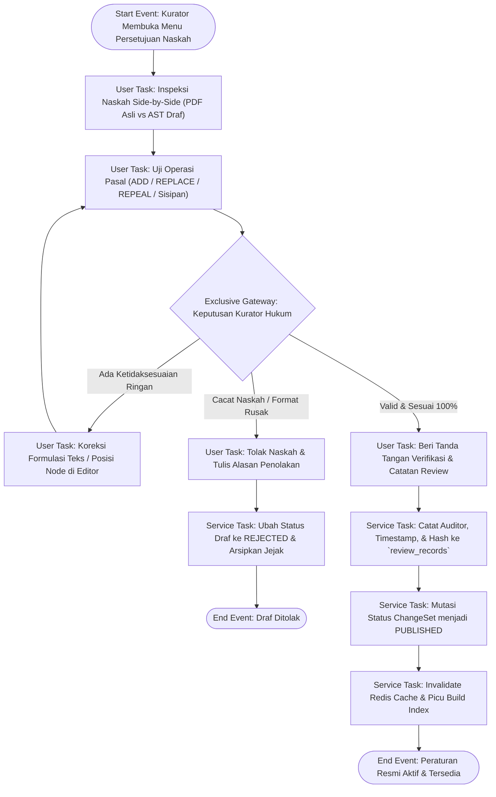
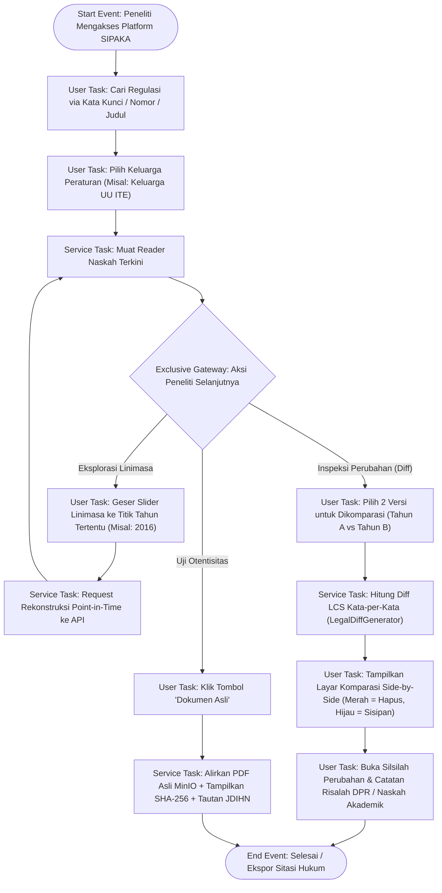

# DOKUMENTASI LENGKAP PROSES BISNIS (BPMN 2.0) — SIPAKA (LEXVERA)
**Platform Version Control & Konsolidasi Perundang-Undangan Indonesia**  
**Standar Kepatuhan:** BPMN 2.0 & ISO 9001:2015 Klausul 7.5.3 (Control of Documented Information)

---

## 1. File Viewer Interaktif Langsung
Untuk melihat seluruh diagram interaktif yang dirender otomatis dengan tab navigasi, cukup buka file berikut di peramban web (*browser*):
👉 [`BPMN_INTERAKTIF_SIPAKA.html`](./BPMN_INTERAKTIF_SIPAKA.html)

---

## 2. BPMN 1: Pipeline Ingesti Data Regulasi & Parsing AST Otomatis

Proses ini menangani deteksi dokumen dari portal resmi (JDIHN/BPK/Setneg/MKRI) hingga pembentukan struktur pohon regulasi (*Abstract Syntax Tree*).

---

## 3. BPMN 2: Kurasi Human-in-the-Loop & Approval Gate (ISO 7.5.3)

Menjamin prinsip *fail-closed*: **mesin tidak pernah menerbitkan teks regulasi secara otonom tanpa verifikasi legal drafter**.

---

## 4. BPMN 3: Mesin Rekonstruksi Konsolidasi Deterministik (*Point-in-Time*)

Proses internal mesin konsolidasi saat menyusun naskah konsolidasi pada tanggal historis tertentu.

```mermaid
flowchart LR
    StartQuery(["Start Event: Request Naskah (slug, Target Date)"]) --> CheckCache{"Exclusive Gateway: Snapshot Tersedia di Redis?"}
    
    CheckCache -- "Hit (Ada)" --> ServeCache["Service Task: Ambil Snapshot Terkompresi"]
    ServeCache --> ReturnResponse(["End Event: Kirim JSON Naskah"])
    
    CheckCache -- "Miss (Belum)" --> FetchBase["Service Task: Ambil Pohon Regulasi Induk dari Database"]
    FetchBase --> FetchOps["Service Task: Kueri Seluruh ChangeOperation Efektif <= Target Date"]
    
    FetchOps --> LoopOps["Sub-Process: Iterasi Rantai Operasi Kronologis (Ascending)"]
    
    subgraph LoopOps [Eksekusi Mutasi Deterministik]
        ApplyAdd["Operasi ADD: Sisipkan Node Baru pada Posisi Fraksional"]
        ApplyReplace["Operasi REPLACE: Mutasi Teks Pasal & Arsipkan Versi Lama"]
        ApplyRepeal["Operasi REPEAL: Beri Flag Dicabut & Nonaktifkan Kekuatan Mengikat"]
        ApplyMK["Operasi BERSYARAT_MK: Tempelkan Anotasi Hermeneutika Putusan MK"]
    end
    
    LoopOps --> BuildTree["Service Task: Rekonstruksi Pohon Konsolidasi Final"]
    BuildTree --> SaveCache["Service Task: Simpan Snapshot Hasil Rekonstruksi ke Cache"]
    SaveCache --> ReturnResponse
```

---

## 5. BPMN 4: Interaksi Peneliti Hukum & Visual Diff Inspector

Alur interaksi pengguna pada frontend Next.js untuk navigasi linimasa dan perbandingan hukum.

